<div align="center">


# Areté

### A coding assessment built from the candidate's *own* portfolio, and graded only by tests.

**Portfolio-Driven Adaptive Coding & Technical Assessment Platform**

<p>
  
  
  
  
  
  
  
  
</p>

<p>
  <a href="#-features"><b>Features</b></a> ·
  <a href="#-screenshots"><b>Screenshots</b></a> ·
  <a href="#-how-it-works"><b>How it works</b></a> ·
  <a href="#-architecture"><b>Architecture</b></a> ·
  <a href="#-getting-started"><b>Getting started</b></a>
</p>

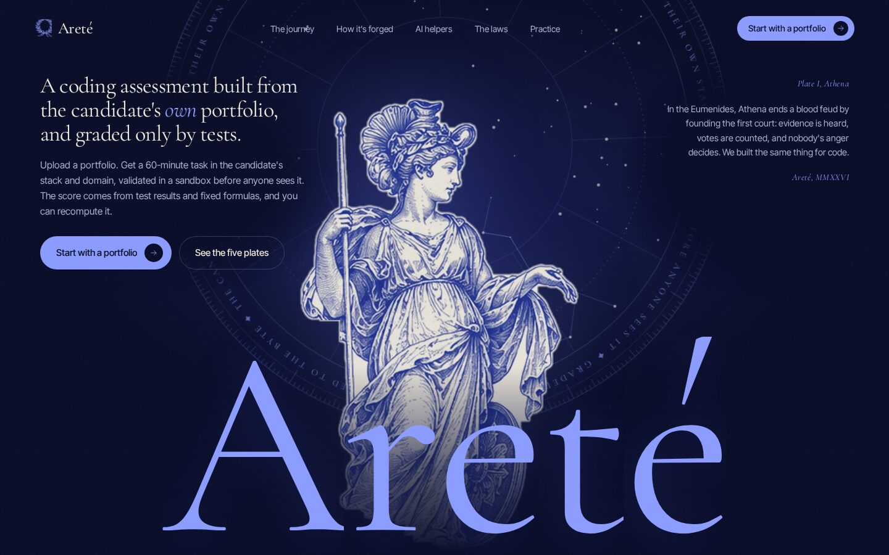

</div>

---

Areté turns a candidate's own record (résumé, GitHub, LeetCode and Codeforces) into a
**validated 60-minute coding assessment in their own domain and tech stack**. Tests
decide correctness, never a language model, and the candidate's code runs only in
locked-down sandboxes.

> [!NOTE]
> **Why it exists.** Generic coding tests ignore what a candidate has actually built,
> and AI coding tools make it hard to tell whether someone understands the work in
> their portfolio. A LeetCode medium says little about whether a person can find a bug
> in a FastAPI service. Areté builds the test from the portfolio instead: the
> candidate's stack, domain, the concepts they claim and the DSA topics they have solved.

<div align="center">
  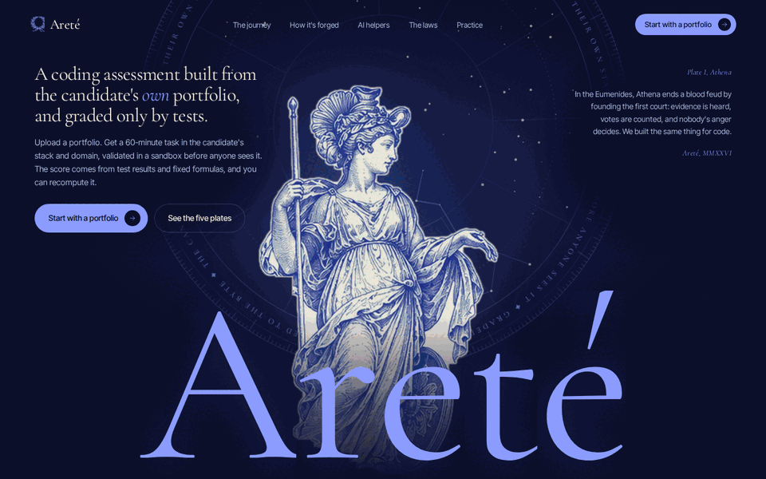
  <br><sub>A quick tour: portfolio → trials → sandboxed runs → labyrinth → oracle → report</sub>
</div>

## ✨ Features

<table>
<tr>
<td width="50%" valign="top">

### 🧬 Built from your portfolio
Résumé, GitHub, LeetCode and Codeforces become a profile (domain, runtime, concepts,
tier) **by plain rules**. A small model is called once, only when the rules can't place
the candidate.

</td>
<td width="50%" valign="top">

### 🏛️ Tasks that prove themselves first
Every task passes a **validation gate** before release: the reference passes three
times in a row, the starter fails, the statement doesn't leak the fix and the tests
have teeth. Each task ships with a certificate.

</td>
</tr>
<tr>
<td valign="top">

### 🔒 Sealed sandboxes
Candidate code runs in a **fresh Docker container per run**: no network, capped CPU,
memory, PIDs and time, non-root user. Hidden tests run in their own sandbox, never
next to visible ones.

</td>
<td valign="top">

### ⚖️ Deterministic scoring
Scores come only from test results and fixed formulas (fail-to-pass, SWE-bench style).
The same events and snapshots always give the same score, and the **Re-grade** button
proves it.

</td>
</tr>
<tr>
<td valign="top">

### 🪽 Hermes, the guarded hint assistant
On Adept and Master, hints climb from concept to function to line, and only after the
candidate runs the tests. Asking for the answer gets a refusal, not a model call.
Using it efficiently counts for up to 20% of the score.

</td>
<td valign="top">

### 🗺️ Trail Map replay
A React Flow map of the task's functions, grouped by file, with the candidate's path
through the code replayed over time: time to target, off-path time, edit precision and
functions visited.

</td>
</tr>
<tr>
<td valign="top">

### 🐂 The Labyrinth
A code-comprehension round in a realistic repo: reported issues to diagnose, analyse,
debug and optimise, with root cause and fix written in the candidate's own words.

</td>
<td valign="top">

### ☀️ The Oracle, an AI voice interviewer
An optional spoken interview about the candidate's own submitted changes. Mic consent
first, transcripts (never audio) stored, no questions about protected attributes, and
it **never affects the score**.

</td>
</tr>
<tr>
<td valign="top">

### 📜 An honest report
Score and band, a per-task table, gate certificates, claim verification against the
portfolio, a progress timeline, hint ROI and integrity notes, plus a four-sentence
summary written only from the report's numbers.

</td>
<td valign="top">

### 🧩 Practice mode
A LeetCode-style problem list with search, difficulty and topic filters, and a
sandboxed IDE with examples, custom input, Run and Submit.

</td>
</tr>
</table>

### Three tiers, picked from the profile

| Tier | Domain task | DSA task | Hint assistant |
| :--- | :--- | :--- | :---: |
| **Novice** | One-file bug, injected by a LibCST mutation engine and kept only if it breaks tests | Easy | — |
| **Adept** | A feature stubbed out across 2–3 files | Medium | ✅ |
| **Master** | A multi-file bug with a performance constraint | Medium or hard | ✅ |

## 📸 Screenshots

All screenshots are from the running app (`make up` + `make seed-demo`).

### The landing page

<table>
<tr>
<td width="50%">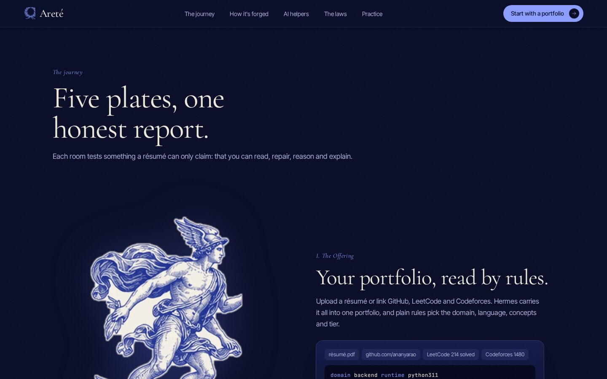<br><sub><b>The journey.</b> Five plates, one honest report.</sub></td>
<td width="50%">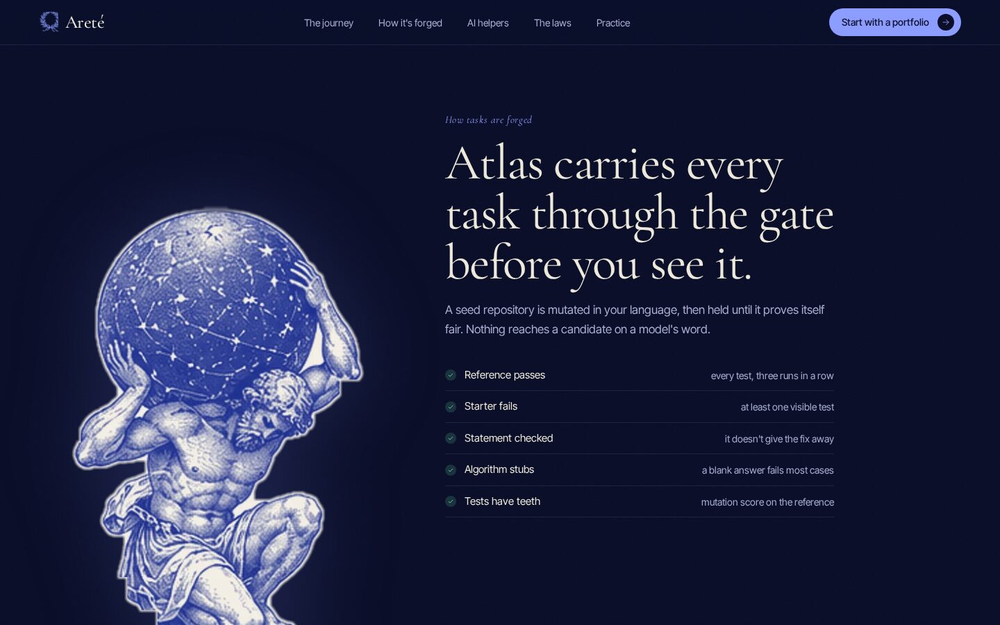<br><sub><b>How tasks are forged.</b> Atlas carries every task through the gate.</sub></td>
</tr>
<tr>
<td>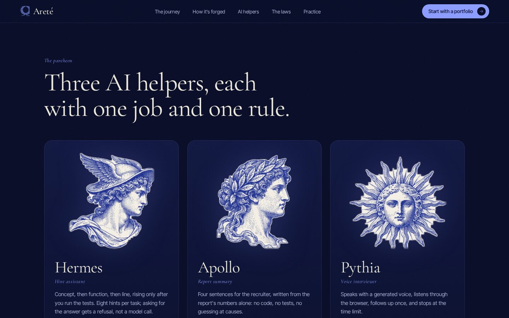<br><sub><b>The pantheon.</b> Three AI helpers, each with one job and one rule.</sub></td>
<td>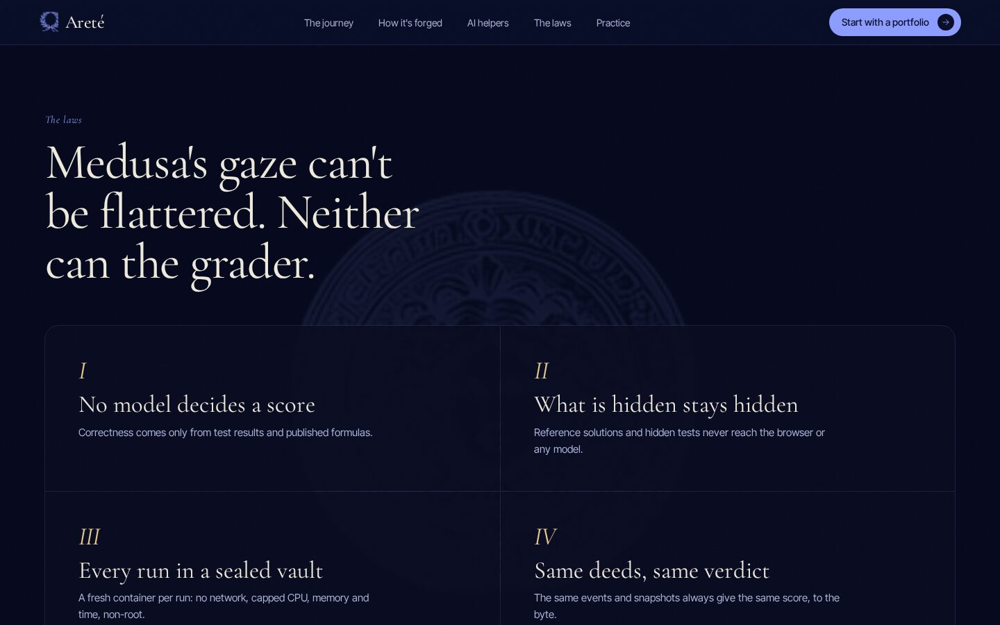<br><sub><b>The laws.</b> No model decides a score; what is hidden stays hidden.</sub></td>
</tr>
</table>

### The candidate journey

<table>
<tr>
<td width="50%">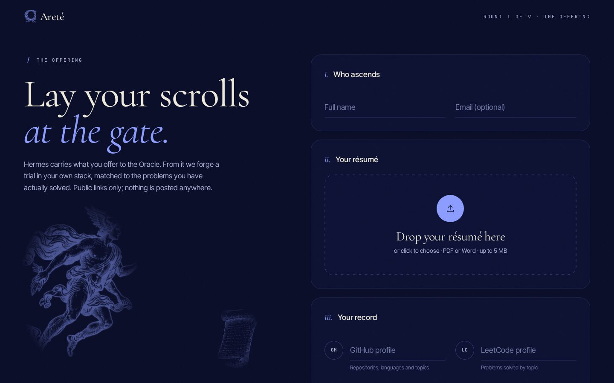<br><sub><b>I · The Offering.</b> Résumé, GitHub and LeetCode go in; a profile comes out.</sub></td>
<td width="50%">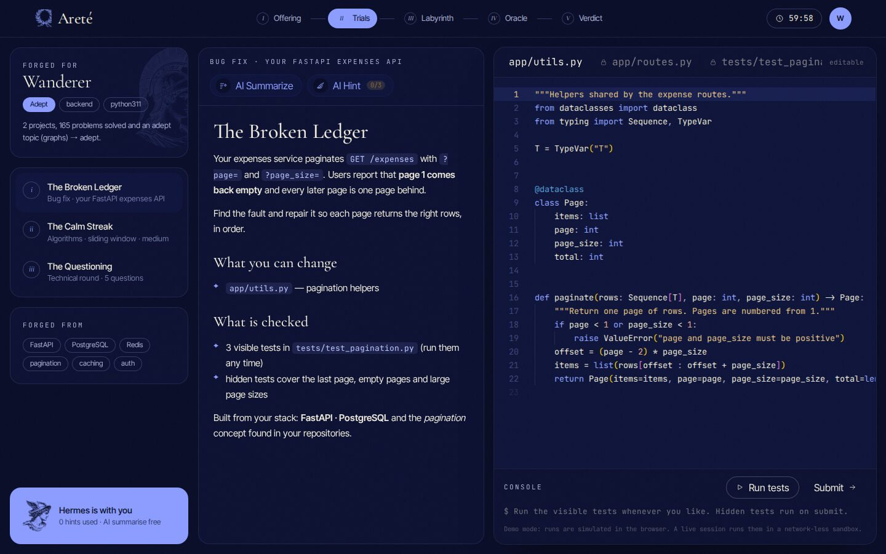<br><sub><b>II · The Trials.</b> A bug fix in the candidate's own stack, with Hermes on hand.</sub></td>
</tr>
<tr>
<td>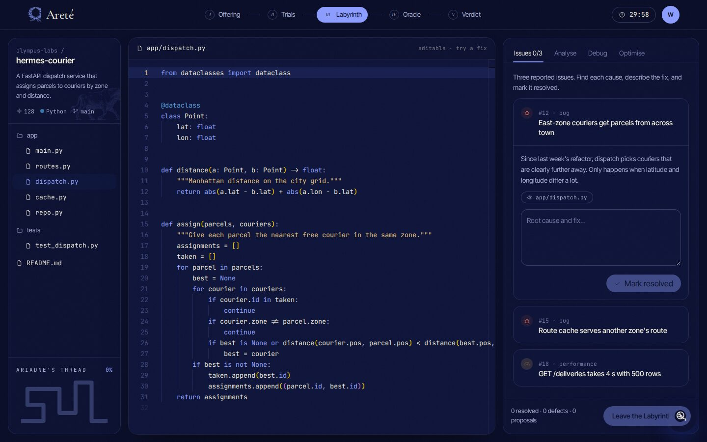<br><sub><b>III · The Labyrinth.</b> Read a real repo, find the cause of each reported issue.</sub></td>
<td>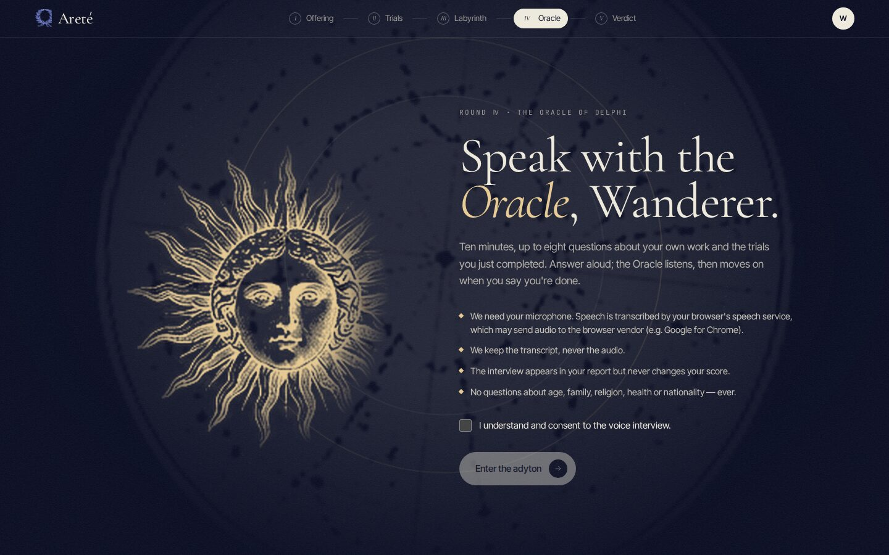<br><sub><b>IV · The Oracle.</b> A consented voice interview about the candidate's own work.</sub></td>
</tr>
<tr>
<td colspan="2" align="center">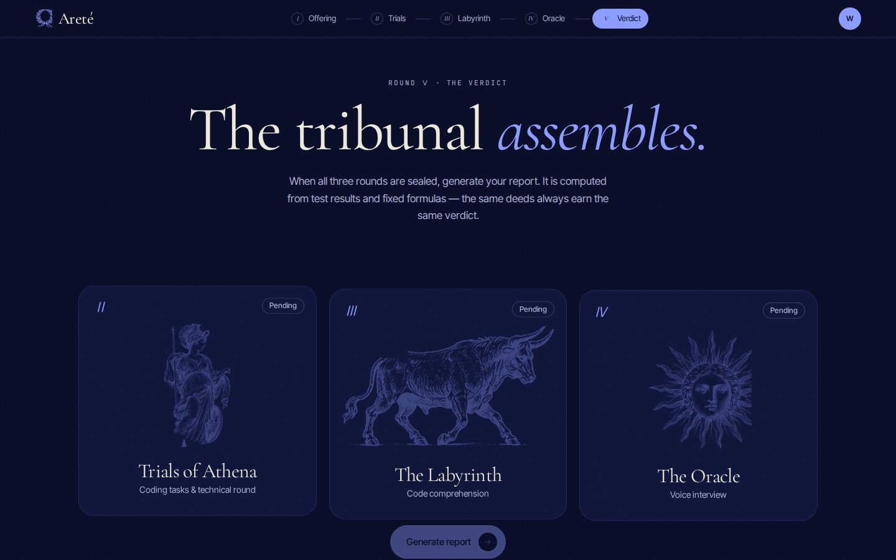<br><sub><b>V · The Verdict.</b> The tribunal assembles once every round is sealed.</sub></td>
</tr>
</table>

### The assessment IDE

Bundled Monaco (no CDN), an editable allowlist (tests and config are locked 🔒),
autosave, a 60-minute timer, and Run / Submit against real sandboxes.

<table>
<tr>
<td width="50%">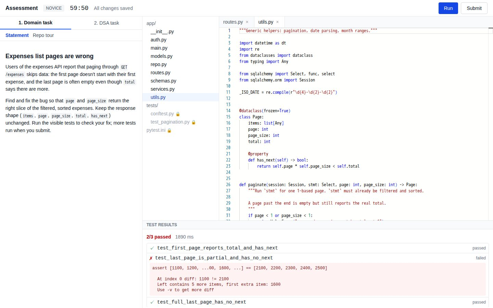<br><sub><b>Run the starter.</b> A visible test fails with the real pytest diff.</sub></td>
<td width="50%">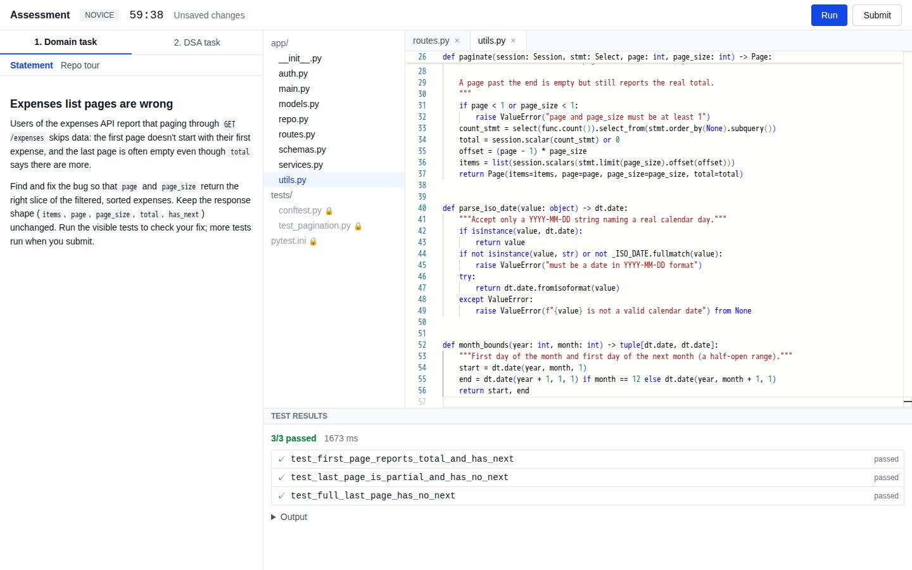<br><sub><b>Fix and re-run.</b> One line later, every visible test passes.</sub></td>
</tr>
</table>

### The report

<table>
<tr>
<td width="50%">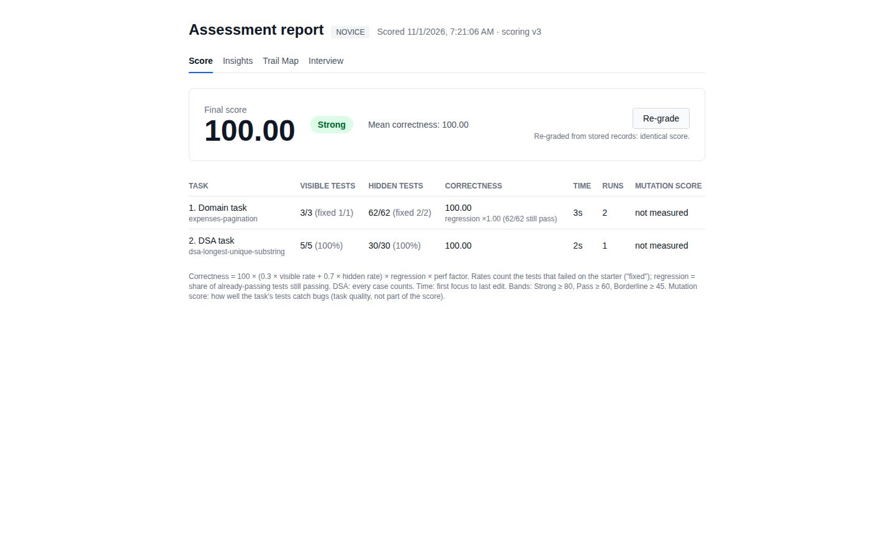<br><sub><b>Score.</b> Final score, band and per-task table. Re-grade gives an identical score.</sub></td>
<td width="50%">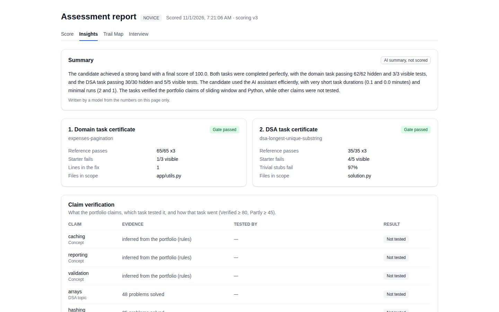<br><sub><b>Insights.</b> Gate certificates, claim verification and a numbers-only summary.</sub></td>
</tr>
<tr>
<td colspan="2">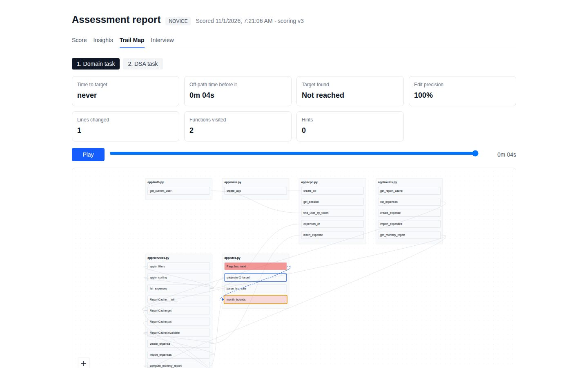<br><sub><b>Trail Map.</b> The candidate's path through the code, replayable, with the bug's location marked.</sub></td>
</tr>
</table>

### Practice mode

<table>
<tr>
<td width="50%">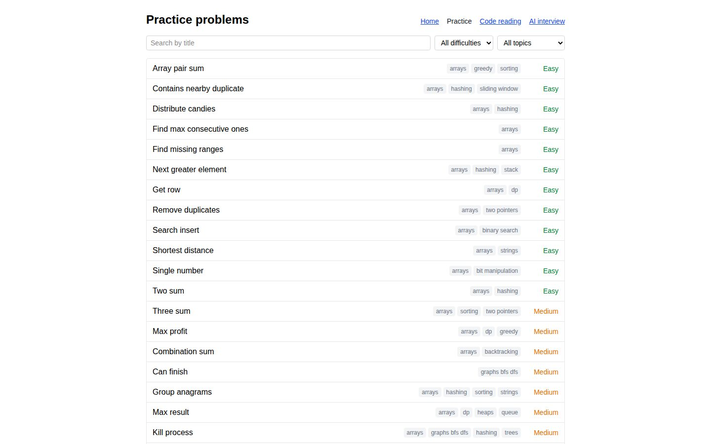<br><sub>About 100 DSA problems, filterable by difficulty and topic.</sub></td>
<td width="50%">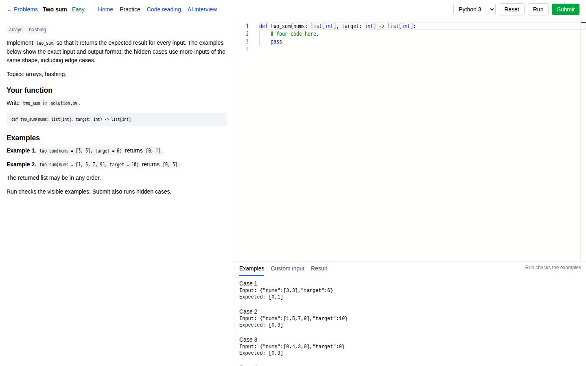<br><sub>A sandboxed IDE with examples, custom input and hidden cases on Submit.</sub></td>
</tr>
</table>

## 🔭 How it works

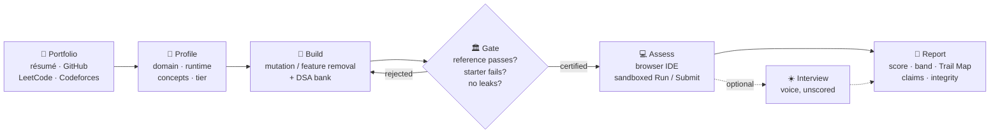

1. **Profile.** The portfolio becomes a profile (domain, runtime, concepts, tier) by
   plain rules. A small model is called once, only when the rules can't place it.
2. **Build.** Two tasks are built from tested seed repos and a DSA bank of about 100
   problems, one domain task and one DSA task per tier (see the table above).
3. **Gate.** The reference solution passes, the starter fails, and the statement
   doesn't leak the answer. Each task gets a certificate.
4. **Assess.** The candidate works in a browser IDE with Run and Submit. Code runs in
   fresh Docker containers; hidden tests run in their own sandbox.
5. **Assist.** On Adept and Master, the guarded hint assistant gives graded hints,
   never solutions.
6. **Report.** A deterministic score and band from test results and fixed formulas.
   Claim verification, the progress timeline, hint ROI, integrity notes and the Trail
   Map are shown but **never** affect the score.
7. **Interview.** The optional AI voice interviewer asks about the candidate's own
   submitted changes.

### Scoring

```text
correctness = 100 × (0.3 × visible rate + 0.7 × hidden rate) × regression × perf factor
```

- Domain tasks count only the tests that failed on the starter (**fail-to-pass**);
  *regression* is the share of already-passing tests that still pass.
- DSA tasks count every case.
- Novice: 100% correctness. Adept and Master: 80% correctness + 20% AI efficiency,
  computed from logs.
- Bands: **Strong** ≥ 80 · **Pass** ≥ 60 · **Borderline** ≥ 45.

## 🏗️ Architecture

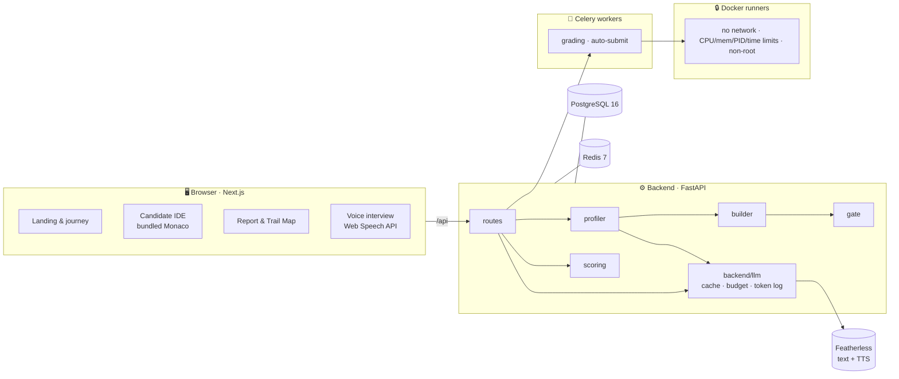

| Layer | Tech |
| :--- | :--- |
| **Backend** | Python 3.11, FastAPI, Pydantic v2, SQLAlchemy 2 + Alembic, Celery + Redis, pytest |
| **Task building** | LibCST mutation and feature-removal engines, seed repos, DSA bank with Python and JS harnesses |
| **LLM** | OpenAI Python SDK against the Featherless API, wrapped with Instructor (JSON mode); model slots for generator, assistant, probe and interviewer; every response cached in Redis, with a hard spend cap |
| **Speech** | Featherless text-to-speech for the interviewer's voice; the browser Web Speech API for listening |
| **Runner** | Docker images per runtime (`runtimes/python311`, `runtimes/node20`) |
| **Frontend** | Next.js (App Router), TypeScript, Tailwind, Monaco, React Flow, assistant-ui, GSAP |
| **Contracts** | JSON Schemas in `contracts/` are the source of truth; Pydantic and TypeScript types are generated from them |
| **Database** | PostgreSQL 16 |

### 🛡️ Design rules

| | Rule |
| :---: | :--- |
| ⚖️ | Language models never decide correctness or scores. |
| 🙈 | Reference solutions and hidden tests never leave the backend: not to the browser, not into any model's context, not in any API response. |
| 🎯 | A run counts only if exactly the task's expected test IDs were collected, and the candidate can edit only starter files outside tests and config. |
| 🔁 | The same events and snapshots always give the same score. |
| 🪙 | Every model call sets `max_tokens` and a low temperature, is cached by input hash, and is logged with its token count. |

## 🚀 Getting started

**Requirements:** Docker with Compose, and GNU Make.

```bash
cp .env.example .env          # add FEATHERLESS_API_KEY for the AI features
make runtimes                 # build the sandbox images
make up                       # postgres, redis, api, worker, beat, frontend
make migrate                  # create the database tables
```

Then open:

| URL | What |
| :--- | :--- |
| http://localhost:3000 | The Areté landing page and candidate journey |
| http://localhost:3000/practice | Practice problems |
| http://localhost:8000/docs | The API (OpenAPI) |

To get a ready-made assessment session (the 60-minute timer starts immediately):

```bash
make seed-demo                # or: make seed-demo TIER=adept / TIER=master
```

It prints a session URL. Fix the bug, press **Run**, then **Submit** to see the report.

> [!TIP]
> The demo flow needs no API key. The hint assistant, task enrichment and voice
> interviewer need `FEATHERLESS_API_KEY`. The report's Insights and Trail Map tabs need
> `RECRUITER_API_KEY` set in `.env`.

<details>
<summary><b>All commands</b></summary>

| Command | What it does |
| :--- | :--- |
| `make up` / `make down` | Start or stop the stack |
| `make migrate` | Apply database migrations |
| `make seed-demo` | Build, validate and open a demo assessment |
| `make test` | Backend tests (pytest, in the api container) |
| `make test-docker` | Runner tests that start real sandbox containers |
| `make e2e` | Headless Chromium drives the full demo flow and checks the scores |
| `make lint` | Linters |
| `make contracts` | Regenerate Pydantic and TypeScript types from the schemas |
| `make mutate SEED=... CONCEPT=...` | List and validate bug candidates for a Novice task |
| `make remove-feature SEED=... [CONCEPT=...]` | Stub a concept and validate an Adept task |
| `make build-master` | Build a Master task with a performance constraint |
| `make gate` | Run the validation gate on a task |
| `make llm-smoke` / `make llm-usage` | Check each model slot; show token use and spend |

</details>

<details>
<summary><b>Project structure</b></summary>

```
.
├── backend/      FastAPI app, profiler, task builders, gate, scoring, assistant,
│                 report, trail map, interviewer, LLM client, runner, tests
├── frontend/     Next.js app: landing and journey, candidate IDE, report, interview, practice
├── contracts/    JSON Schemas (source of truth), fixtures, generated types
├── seeds/        Hand-written seed repos with tests and concept maps
├── dsa/          DSA problem bank and topic taxonomy (backend only)
├── runtimes/     Dockerfiles for the sandbox images
├── sim/          Simulated candidate scripts
├── e2e/          Headless end-to-end demo test
└── docs/         Blueprint, build prompts, progress, interviewer spec
```

</details>

More detail: [docs/BLUEPRINT.md](docs/BLUEPRINT.md) (architecture, scoring, threat
model) and [docs/INTERVIEWER.md](docs/INTERVIEWER.md) (voice interviewer).

## 🙏 Credits

Open-source libraries, datasets and adapted methods are listed in
[ATTRIBUTIONS.md](ATTRIBUTIONS.md).

## 📄 License

[MIT](LICENSE)
